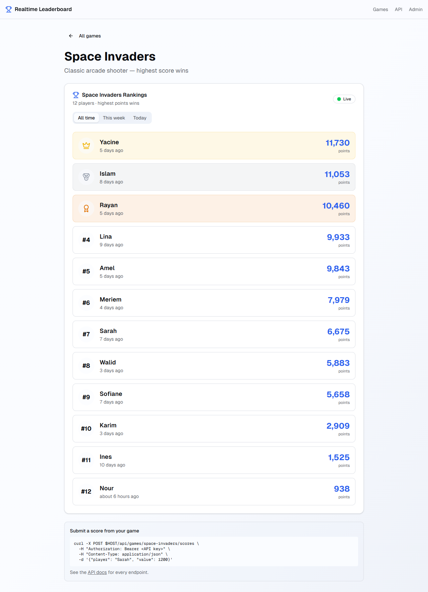
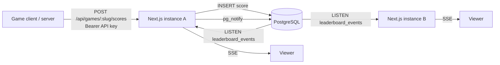
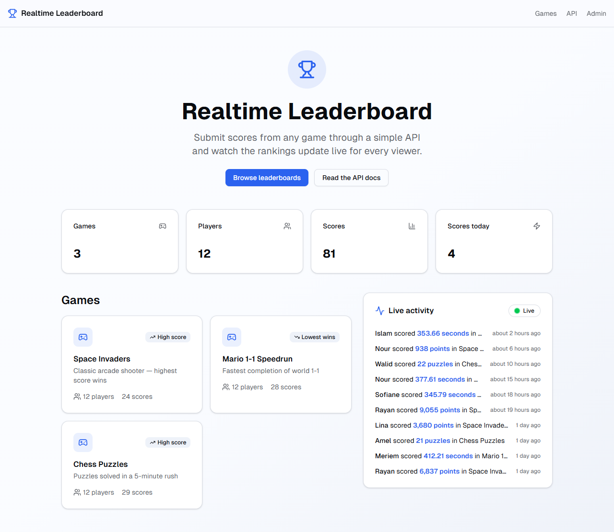
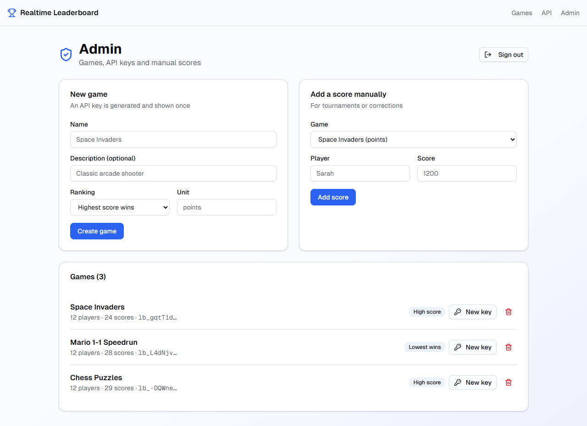

# 🏆 Realtime Leaderboard


A leaderboard service for any game: games submit scores through a REST API, and every viewer sees the rankings update **live** — no refresh, across any number of server instances.



## ✨ Features

- ⚡ **Live rankings** with Server-Sent Events — new scores, rank changes and newcomers are highlighted as they happen
- 🔑 **REST API with per-game API keys** — keys are generated once, stored as SHA-256 hashes, and can be rotated
- 🏅 **Proper ranking rules** — best score per player, competition ranking for ties ("1224"), earliest achiever first
- ⏱️ **High-score or lowest-wins games** — points for arcade games, times for speedruns
- 📅 **Period filters** — all time, this week, today
- 📡 **Live activity feed** on the home page across all games
- 🛡️ **Admin dashboard** — create and delete games, rotate keys, add scores manually (signed session cookie)
- 🚦 **Rate limiting** on score submission (token bucket, `429` + `Retry-After`)

## 🏗️ Architecture



When a score is saved, the instance publishes an event with PostgreSQL `NOTIFY`. Every instance keeps one `LISTEN` connection and forwards events to its connected browsers over **Server-Sent Events**, so viewers connected to different servers stay in sync without Redis or a separate WebSocket server. Bursts of scores are coalesced (200 ms) into a single ranking refresh per viewer.

Rankings are computed in SQL with `DISTINCT ON (playerId)` to take each player's best score in the period, then ranked in TypeScript ([`lib/ranking.ts`](lib/ranking.ts)).

## 📡 API

| Method | Endpoint | Description |
|--------|----------|-------------|
| `POST` | `/api/games/:slug/scores` | Submit a score — `Authorization: Bearer <key>`, body `{ "player": "Sarah", "value": 1200 }` → `201` with the player's rank |
| `GET` | `/api/games/:slug/leaderboard?period=all\|week\|day` | Current ranking |
| `GET` | `/api/games/:slug/stream?period=…` | SSE: `leaderboard`, `score`, `game-deleted` events |
| `GET` | `/api/stream` | SSE: recent scores, then every new score |
| `GET` | `/api/games` | Games with player and score counts |
| `GET` | `/api/health` | Liveness + database check |

```bash
curl -X POST http://localhost:3000/api/games/space-invaders/scores \
  -H "Authorization: Bearer lb_xxxxxxxx" \
  -H "Content-Type: application/json" \
  -d '{"player": "Sarah", "value": 1200}'
```

Errors: `401` invalid key · `404` unknown game · `422` invalid body (with per-field details) · `429` rate limited. Full reference on the `/docs` page.

## 🛠️ Tech Stack

**App** — Next.js 14 (App Router, Route Handlers, Server Actions), React 18, TypeScript, Tailwind CSS 4, shadcn/ui
**Data** — PostgreSQL 16, Prisma 6 (schema, migrations, seed), `pg` for `LISTEN/NOTIFY`
**Realtime** — Server-Sent Events with heartbeats and automatic reconnection
**Security** — hashed API keys, HMAC-signed admin session (Web Crypto), constant-time comparisons, Zod validation, rate limiting
**Quality** — Vitest unit tests, strict TypeScript build

## 🚀 Getting Started

Requirements: Node.js 20+ and Docker.

```bash
git clone https://github.com/adelmerad/Realtime-Leaderboard.git
cd Realtime-Leaderboard
npm install

cp .env.example .env     # set AUTH_SECRET and ADMIN_PASSWORD
npm run db:up            # PostgreSQL in Docker (port 5434)
npm run db:migrate
npm run db:seed          # 3 demo games — prints their API keys
npm run dev
```

Open http://localhost:3000, and http://localhost:3000/admin to manage games with your `ADMIN_PASSWORD`.

| Command | Description |
|---------|-------------|
| `npm run dev` | Development server |
| `npm run build` | Generate the Prisma client and build for production |
| `npm test` | Unit tests |
| `npm run db:deploy` | Apply migrations in production |

## 📸 Screenshots

| Home with live activity | Admin dashboard |
|-------------------------|-----------------|
|  |  |

## 📂 Project Structure

```
app/
├── api/              # REST + SSE endpoints (scores, leaderboard, streams, health)
├── games/[slug]/     # Live leaderboard page
├── admin/            # Dashboard and login
├── actions/          # Admin server actions
└── docs/             # API reference page
components/           # Live leaderboard, activity feed, SSE hook
lib/
├── ranking.ts        # Ranking rules, periods
├── leaderboard.ts    # Ranking queries
├── realtime.ts       # LISTEN/NOTIFY hub
├── sse.ts            # Server-Sent Events responses
├── api-keys.ts       # Key generation and hashing
├── admin-session.ts  # Signed session cookie
└── rate-limit.ts     # Token bucket
prisma/               # Schema, migrations, seed
tests/                # Vitest unit tests
```

## 🧪 Tests

```bash
npm test
```

Unit tests cover ranking and ties, sort orders, period boundaries, validation, API key hashing, session signing and expiry, rate limiting and SSE encoding.

## 📝 Notes

- Started as a frontend prototype storing data in `localStorage` (September 2025); v2 adds the database, the API and real-time updates.
- The rate limiter is in memory, per instance — behind a load balancer it should move to a shared store such as Redis.
